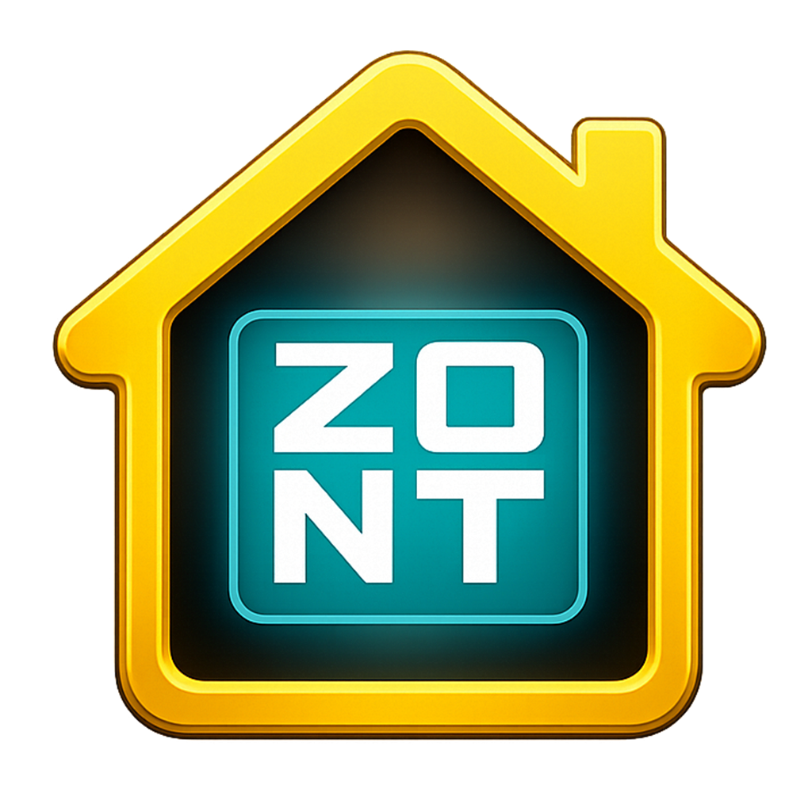

# Homebridge ZONT Thermostat

<p align="center">
  
</p>

Homebridge 2 dynamic platform plugin that exposes ZONT heating circuits as HomeKit thermostats.

The plugin uses ZONT Widget API v3 and the Homebridge plugin settings UI. It does not use analytics, tracking, post-install system modifications, or legacy ZONT API endpoints.

## Requirements

- Homebridge `^2.0.0`
- Node.js `^22.12.0` or `^24.0.0`
- ZONT account with access to supported heating devices
- ZONT Widget API v3 access

## Features

- Custom Homebridge settings page.
- ZONT token generation from login/password via `POST /authtokens`.
- Device discovery via `GET /devices?fields=circuits,modes,sensors,connection`.
- Per-device and per-circuit selection.
- Automatic HomeKit `Thermostat` creation for selected circuits.
- Target temperature write-back via `POST /devices/{device_id}/circuits/{entity_id}/actions/target-temp`.
- Dynamic HomeKit target temperature `min`, `max`, and `step` from ZONT circuit data.
- Technical circuits (`boiler`, `dhw`) are not selected by default.
- Accessory name format can be either `Device - Circuit` or `Circuit only`.

## Installation

Install from the Homebridge UI Plugins page by searching for:

```text
homebridge-zont-thermostat
```

Or install with npm in your Homebridge environment:

```bash
npm install -g homebridge-zont-thermostat
```

Restart Homebridge after installation.

Platform-specific notes are available in [Synology Deployment](docs/synology-deployment.md).

## Configuration

Open the plugin settings in Homebridge UI.

1. Fill `Client Email (X-ZONT-Client)`.
2. Fill ZONT `Login` and `Password`.
3. Click `Get Token by Login/Password`.
4. Click `Load Devices and Circuits`.
5. Select devices and circuits to expose to HomeKit.
6. Choose accessory naming mode.
7. Click the standard Homebridge `Save` button.
8. Restart Homebridge when prompted.

After token generation, login/password may be removed from the config if you prefer to keep only the token.

## Config Example

```json
{
  "platform": "ZontPlatform",
  "name": "ZONT",
  "clientEmail": "user@example.com",
  "token": "zont-token",
  "pollInterval": 30,
  "accessoryNameMode": "circuit_only",
  "selectedDevices": [
    {
      "id": 123456,
      "includeAll": false,
      "includeCircuitIds": [1111, 2222]
    }
  ]
}
```

## Configuration Fields

- `platform`: must be `ZontPlatform`.
- `name`: display name for the platform.
- `clientEmail`: value for the required ZONT `X-ZONT-Client` header.
- `login`: optional after token is saved; used to create a token.
- `password`: optional after token is saved; used to create a token.
- `token`: ZONT API token.
- `pollInterval`: polling interval in seconds. Minimum runtime value is 10 seconds.
- `accessoryNameMode`: `device_and_circuit` or `circuit_only`.
- `selectedDevices`: selected ZONT devices and circuits.

## Troubleshooting

### Plugin UI Shows Manual Config Instead Of Custom UI

Check package/schema discovery in the Homebridge environment:

```bash
node -e "const fs=require('fs'); const p=require.resolve('homebridge-zont-thermostat/package.json'); console.log(p); console.log(fs.existsSync(p.replace('package.json','config.schema.json')));"
```

Expected output includes the package path and `true`.

### Missing `@homebridge/plugin-ui-utils`

Run inside the plugin directory:

```bash
npm install --omit=dev
```

### `No loaded plugin could be found for the name`

This means the plugin name used for accessory registration does not match `package.json.name`. For this package, both must use `homebridge-zont-thermostat`.

### HomeKit Invalid Name Warning

ZONT circuit names may contain trailing or duplicate spaces. The plugin trims and normalizes accessory names before exposing them to HomeKit.

### ZONT Network Errors

Network errors are logged with operation and low-level cause when Node provides it, for example DNS or connection reset information.

## Development

This project is plain CommonJS JavaScript.

Install dependencies:

```bash
npm install
```

Run syntax checks:

```bash
npm run lint
```

Run automated tests:

```bash
npm test
```

Run all local checks:

```bash
npm run check
```

The test suite includes a live ZONT Widget API v3 discovery smoke-test. It is skipped unless credentials are provided through environment variables:

```bash
ZONT_CLIENT_EMAIL="user@example.com" ZONT_TOKEN="token" npm test
```

Optionally limit the live smoke-test to one device:

```bash
ZONT_CLIENT_EMAIL="user@example.com" ZONT_TOKEN="token" ZONT_DEVICE_ID="123456" npm test
```

Do not commit ZONT credentials or tokens.

Check package contents before publishing:

```bash
npm pack --dry-run
```

## Homebridge Verified Readiness

The plugin is designed to follow Homebridge Verified requirements:

- dynamic platform plugin,
- Homebridge plugin settings GUI,
- Node.js 22 and 24 support,
- no analytics or tracking,
- no post-install scripts that modify the user's system,
- no required TTY or non-standard Homebridge startup parameters,
- runtime errors are caught and logged by the plugin.

## Documentation

- [Architecture](docs/architecture.md)
- [ZONT API v3 Mapping](docs/zont-api-v3.md)
- [Homebridge Integration](docs/homebridge-integration.md)
- [Testing](docs/testing.md)
- [Synology Deployment](docs/synology-deployment.md)
- [Release Checklist](docs/release-checklist.md)

## License

MIT
